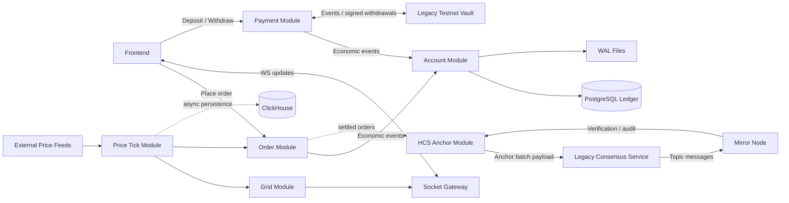

# Tap on Legacy

Tap, a real-time price-grid betting platform integrated with the Legacy Testnet blockchain.

This repository contains the services that power pricing, grid generation, order execution, balance accounting, payment orchestration, and realtime delivery to clients. The onchain custody boundary is intentionally narrow and currently centered on [`smart-contracts/Vault.sol`](./smart-contracts/Vault.sol).

## Delivery Progress

| Feature | Status |
|---|---|
| Real-time offchain order engine | `DONE` |
| Signed grid generation and order intent validation | `DONE` |
| Strongly consistent account ledger and WAL | `DONE` |
| Legacy Testnet vault integration for custody boundary | `DONE` |
| Settled-order batch anchoring to Legacy Consensus Service | `DONE` |
| Merkle proof generation for anchored settled orders | `DONE` |
| Topic verification through Legacy mirror node | `DONE` |
| Admin-triggered anchor batch execution | `DONE` |
| Automatic anchor batch cron every minute | `DONE` |
| HBAR-native vault flow in `Vault.sol` | `TODO` |
| Production hardening for HCS retries and reconciliation | `TODO` |

## Deploy Contract

Vault contract deployed on Legacy Testnet at: 0xd5cB4c9E796D8FCCb2C9B865aDCeBd2F02aE948d

## System Context

Tap keeps latency-sensitive gameplay offchain and uses Legacy Testnet as the settlement and custody boundary for deposits and withdrawals.



## Legacy Consensus Service Integration

The backend now includes a full settled-order anchoring pipeline on Legacy Consensus Service (HCS).

### Why HCS is used here

- Order execution and settlement remain offchain to preserve low latency.
- HCS adds decentralized ordering, timestamping, and public verifiability for the post-settlement audit trail.
- Each settled-order batch is compressed into a Merkle root before submission, so the public anchor remains small while individual user records can still be proven against the anchored batch.

### Current integration model

1. Orders settle inside the backend order engine.
2. Settled orders that have not yet been anchored are grouped into a batch.
3. The backend canonicalizes each settled order, hashes the records, and builds a Merkle tree.
4. A compact anchor payload containing the Merkle root and batch metadata is submitted to an HCS topic.
5. The batch stores:
   - `topicId`
   - `sequenceNumber`
   - `runningHash`
   - `consensusTimestamp`
6. Individual orders store:
   - `anchorBatchId`
   - `anchorLeafHash`
   - `anchoredAt`
7. Operators can verify the anchored topic message through the Legacy mirror node and retrieve an order-level Merkle proof from the backend.

### Operational surfaces

- Manual trigger:
  - `POST /api/v1/hcs-anchor/run`
  - `yarn run:hcs-anchor`
- Batch inspection:
  - `GET /api/v1/hcs-anchor/batches`
  - `GET /api/v1/hcs-anchor/batches/:batchId`
- Topic verification:
  - `GET /api/v1/hcs-anchor/batches/:batchId/verify-topic`
  - `yarn verify:hcs-topic-anchor <batchId>`
- Order proof retrieval:
  - `GET /api/v1/hcs-anchor/orders/:orderId/proof`
  - `yarn verify:hcs-anchor <orderId>`

### Automation

- A scheduler runs every minute and automatically submits a new anchor batch whenever there are settled orders that have not yet been anchored.
- This behavior is controlled by `HCS_AUTO_ANCHOR_ENABLED`.

### Configuration

The HCS integration is controlled through `.env` values read by [`src/config/index.ts`](./src/config/index.ts):

```env
HCS_MODE=legacy
HCS_TOPIC_ID=0.0.8338163
LEGACY_NETWORK=testnet
LEGACY_OPERATOR_ID=0.0.xxxxx
LEGACY_OPERATOR_KEY=302e...
LEGACY_MIRROR_NODE_URL=https://testnet.mirrornode.example.com
HCS_CREATE_TOPIC_IF_MISSING=false
HCS_TOPIC_MEMO=hedetap settled-order anchors
HCS_AUTO_ANCHOR_ENABLED=true
```

### Notes on scope

- HCS is used as the consensus-backed anchoring layer, not as the real-time execution engine.
- The low-latency betting path remains in memory and offchain.
- Legacy is currently integrated for:
  - settlement and custody boundary via the vault contract
  - consensus-backed anchoring of settled-order batches via HCS
- The next onchain scope after this integration is adapting [`smart-contracts/Vault.sol`](./smart-contracts/Vault.sol) for HBAR-native deposit and withdrawal flows.

## Architecture Highlights

These highlights are distilled from the docs in [`system-design/`](./system-design/).

### 1. Real-time price pipeline

- The Price Tick module ingests exchange data, canonicalizes timestamps, fills gaps when needed, and fans out an ordered tick stream without blocking on persistence.
- ClickHouse is used for historical price storage, while the realtime path stays in memory.

Relevant docs:
- [`system-design/overall.md`](./system-design/overall.md)
- [`system-design/price_tick/price_tick_module.md`](./system-design/price_tick/price_tick_module.md)

### 2. Signed grid generation

- The Grid module converts each canonical price tick into a rolling price-time grid.
- Every cell carries reward metadata and a backend signature so the frontend can submit cryptographically verifiable order intents.

Relevant doc:
- [`system-design/grid/grid_module.md`](./system-design/grid/grid_module.md)

### 3. Low-latency order engine

- Orders are validated on the hot path with duplicate prevention, cutoff checks, and token-bucket rate limiting.
- Active orders live in memory and are bucketed by cell end-time for fast settlement and eviction.
- Order processing emits economic events to the account system instead of mutating balances directly.

Relevant doc:
- [`system-design/orders/order_management.md`](./system-design/orders/order_management.md)

### 4. Strongly consistent balance accounting

- The Account module is the single writer for user balances.
- Per-user serialization is achieved through shard queues.
- WAL records intent durability, PostgreSQL ledger entries record economic facts, and in-memory balance state is treated as a rebuildable projection.

Relevant docs:
- [`system-design/accounts/account_balance_management.md`](./system-design/accounts/account_balance_management.md)
- [`system-design/accounts/WAL_Ledger.md`](./system-design/accounts/WAL_Ledger.md)

### 5. Payment bridge for Legacy Testnet

- The Payment module bridges offchain balances with onchain deposit and withdrawal flows.
- Deposits are driven by trusted onchain events from Legacy Testnet.
- Withdrawals use session-based orchestration, signed approvals, idempotency keys, and account-layer locking to ensure correctness.

Relevant doc:
- [`system-design/payment/payment_module.md`](./system-design/payment/payment_module.md)

## Modules In This Repo

Core NestJS modules live under [`src/modules/`](./src/modules):

| Module | Responsibility |
|---|---|
| `auth` | API auth, JWT, API key guards |
| `socket` | Realtime websocket delivery |
| `price` | Price ingestion, OHLC, tick distribution |
| `grid` | Grid snapshot computation and signing |
| `order` | Order placement, active-order lifecycle, settlement |
| `account` | Balance state, WAL, ledger, shard queues |
| `payment` | Deposit / withdraw orchestration with Legacy Testnet |
| `distribution` | Distribution and downstream fund flow support |
| `health-check` | Service health endpoints |

## Onchain Boundary

The only contract surface that should be highlighted in this repository is:

| File | Role |
|---|---|
| [`smart-contracts/Vault.sol`](./smart-contracts/Vault.sol) | Tap custody vault for LP shares, trader deposits/claims, and solvency reporting used by the Legacy Testnet integration boundary |

All other older contract descriptions have been intentionally omitted from this README because they are not the active focus of this backend repository.

## Local Development

### Prerequisites

- Node.js
- npm
- Docker / Docker Compose

### Infrastructure services

The repo provides local containers for PostgreSQL, Redis, MinIO, Kafka, ZooKeeper, and ClickHouse:

```bash
cp docker.env.example docker.env
docker compose up -d
```

### Application setup

1. Create `.env` with the variables required by [`src/config/index.ts`](./src/config/index.ts).
2. Install dependencies.
3. Start the backend.

```bash
npm install
npm run dev
```

The app starts with:

- REST API under `/api`
- Swagger in non-production at `/swagger`
- WebSocket support via the socket module

## Useful Commands

```bash
npm run dev
npm run build
npm run test
npm run test:e2e
npm run migration:up
```

## References

- [`system-design/`](./system-design/)
- [`onchain-events.md`](./onchain-events.md)
- [`ADAPTER_GUIDE.md`](./ADAPTER_GUIDE.md)
- [`cre-export-api.md`](./cre-export-api.md)
